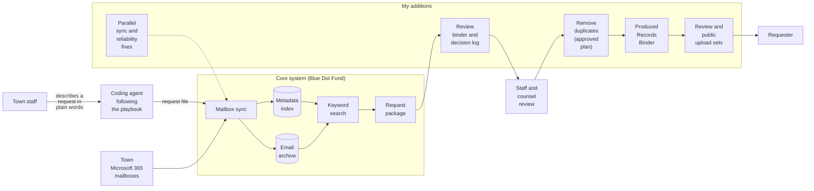

# Marineland Records Platform

**Formal name:** Marineland Public Intelligence Platform
**Organization:** Town of Marineland, Florida
**Period:** 2026
**Status:** Used for the Town's public records requests in 2026

An email records system that synchronizes the Town's Microsoft 365
mailboxes, searches them for a public records request, and produces review
and release binders. The original core system was built by Blue Dot Fund; my
contributions are described separately below.

## 1. Problem

A Florida town must answer public records requests, which often ask for every
email on a topic across several staff mailboxes over months or years. Doing
this by hand means searching each mailbox, exporting messages and
attachments, removing duplicates, and assembling a package that staff and
counsel can review before anything is released. It is slow and hard to do
consistently, and the result has to be complete and traceable.

## 2. My role

**Original core system:** The original core system was built by Blue Dot
Fund. It covers mailbox
synchronization through Microsoft Graph, storage of the email archive in
Amazon S3, a MySQL metadata index, keyword search, request packaging
(spreadsheet, readable emails, attachments and summary), and the first
version of the agent playbook that lets staff run a request by describing it
to a coding agent.

**My contributions (September to October 2026):** I defined the
requirements, directed an AI coding agent (Claude Code) that wrote the code
and tests, reviewed every change, and merged it. All 21 of my code commits
are recorded as co-authored with Claude. The work added about 3,900 lines of
code and tests:

- **Review-binder pipeline:** turns a finished search into a review binder
  PDF, a decision log for reviewers, and a plain-language start guide; builds
  upload sets for a group of requests (an internal review set and a public
  set).
- **Produced Records Binder:** converts a review binder into the copy for the
  requester, changing only the front matter and verifying that every record
  page is unchanged.
- **De-duplication pass:** removes bulk and mailing-list mail, merges Sent and
  Received copies of the same email, and prints a repeated attachment only
  once. It shows a plan for approval first, keeps anything that mentions a
  request's topic for a person to decide, and verifies every output.
- **Parallel sync:** mailbox folders and messages synchronize in parallel,
  with a limit on calls per mailbox and longer back-off when the mail service
  throttles requests.
- **Search fix:** keywords now match the real sender and recipients of each
  message, not the mailbox owner.
- **Reliability fixes:** automatic sign-in token refresh during long syncs,
  stopping a sync promptly when one folder fails, faster scanning, clear
  reporting of password-protected PDFs, and output folder names that are
  valid on Windows and traceable to spreadsheet rows.
- **Offline tests:** expanded the automated suite from 27 to 86 tests, none of
  which contact live services.
- **Agent playbook (co-written):** added the binder-production and branch
  sections to the playbook Blue Dot Fund started, and wrote a branch guide for
  the next engineer.

## 3. System architecture

## 4. Tech stack

- Python
- Microsoft Graph (Microsoft 365 mail)
- AWS: Amazon S3 for the archive
- MySQL for the metadata index
- PDF processing for binders and attachment text
- openpyxl for spreadsheets and decision logs
- pytest for offline automated tests
- Claude Code as the AI coding agent, guided by the repository's agent
  playbook

## 5. Key features

- Natural-language requests: staff describe a request to a coding agent,
  which writes a saved, auditable request file, runs it and reports the
  results.
- Synchronization of the requested mailboxes' received and sent mail before
  every search.
- Whole-word, case-insensitive keyword search over subject, body, PDF
  attachments, and sender and recipient fields.
- A request package with a spreadsheet, readable emails, original
  attachments, a summary and a log; problem emails are packaged separately
  for manual review.
- Review binders with an index, bookmarks, highlighted keywords and a
  decision log for responsiveness and exemption decisions.
- A release copy for the requester that removes duplication without changing
  any record, with every removal shown for approval first.

## 6. Security and data protection

- Access to Town mail is limited to authorized people and services.
- Credentials are managed outside the code.
- Existing outputs are never overwritten without explicit approval.
- Staff and counsel review every binder before anything is released.

## 7. Testing and validation

- 86 offline automated tests, up from 27 before my work. They run without
  contacting Microsoft 365, the cloud archive or the database.
- The binder tools verify their own outputs, and a run fails if any check
  fails: record pages, images, links and bookmarks must be unchanged, and
  removed records must not appear in the index.
- De-duplication always runs as a plan first, which a person reviews before
  the build.
- Each feature and fix was kept on its own branch and merged only after the
  full test suite passed.

## 8. Results

- Used for the Town's public records requests in 2026, with review binders
  and upload sets built from the results.
- Per the public record (Town Commission minutes, March 19, 2026), the system
  as a whole had processed about 31,000 emails across all Town email
  addresses. This figure covers the system overall, not my later
  additions.

## 9. What I would build next

- Incremental synchronization that copies only mail changed since the last
  sync.
- Searching Word and Excel attachments and scanned PDFs (with OCR), in
  addition to PDF text.
- Synchronization of every mail folder, not only Inbox and Sent Items.
- Support for mailbox exports, so records from former mail systems can be
  included.

---

Descriptions only. Source code is private. All rights reserved.
