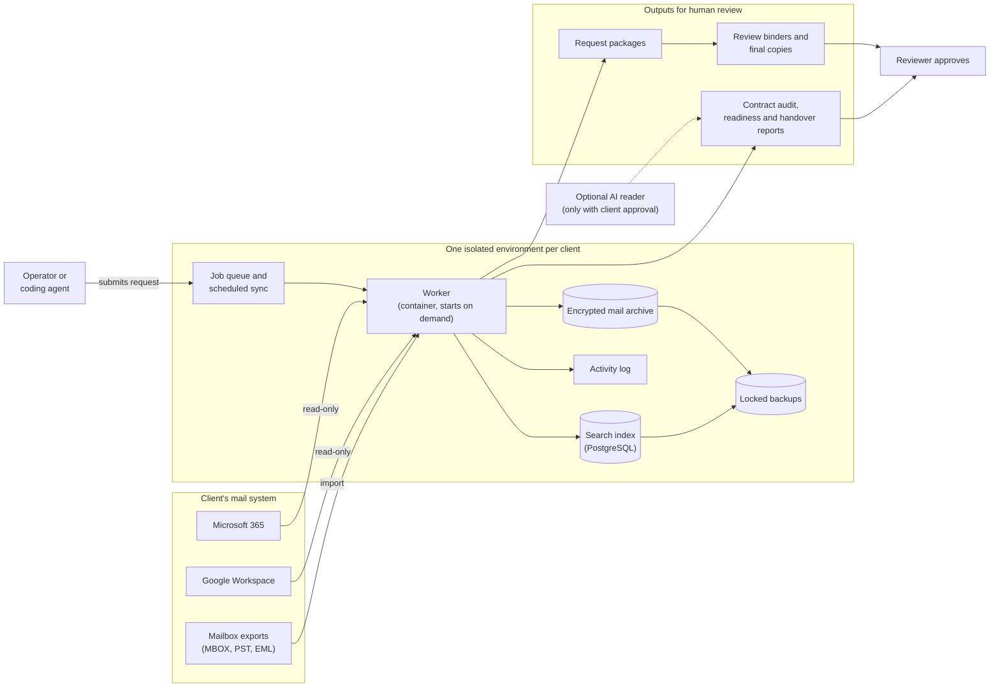

# Private Intelligence Platform

**Organization:** It Just Gets Better LLC
**Period:** October 2026 to present
**Status:** In development; pre-revenue

A platform that lets a private business or non-profit search, organize and
package its own email and records, and audit its contracts, while every
client's data stays in its own isolated environment.

## 1. Problem

Small organizations often need to find and hand over their own records: for a
legal or funder request, a staff departure, a sale or succession, or a
contract renewal. Their records sit in Microsoft 365 or Google Workspace
mailboxes and shared folders, and finding the right emails and agreements by
hand is slow, inconsistent and hard to document.

The platform answers questions such as "find every email about this grant
since 2021", "which agreements do we have, what is missing and what is coming
due" and "what does this departing person's role depend on", and produces
outputs a reviewer can check and approve.

## 2. My role

- **What I did:** As founder, system designer and technical lead, I defined
  the product, the requirements and the multi-tenant architecture, decided the
  security and data-protection controls, set the testing and release rules,
  and reviewed every change before it was merged.
- **What an AI coding agent wrote under my direction:** Claude Code wrote the
  application code, infrastructure code, tests and much of the documentation
  from my requirements and designs. The repository history holds 624
  commits under my account (October 18 to November 14, 2026, merge commits
  included; automated dependency updates excluded), and 409 of them are
  recorded as co-authored with Claude. I directed the
  work, reviewed the results and decided what was merged.
- **What others contributed:** Dependency updates were proposed by an
  automated dependency service.

## 3. System architecture

The software is also built to run on an on-site appliance at the client,
where the archive and index stay on the device and no cloud account is used.
No appliance is deployed yet.

## 4. Tech stack

- **Language and data:** Python, PostgreSQL (with row-level security), SQLite
  for the on-site appliance, pandas, openpyxl
- **Mail sources:** Microsoft Graph (Microsoft 365), Gmail API (Google
  Workspace), importers for MBOX, PST and EML exports
- **Cloud:** AWS (Organizations, IAM Identity Center, S3, RDS, KMS, ECS
  Fargate, SQS, EventBridge Scheduler, AWS Backup, Secrets Manager)
- **Infrastructure as code:** Terraform, with automated module tests
- **Documents:** PDF text extraction, Tesseract OCR for scanned pages,
  WeasyPrint and pypdf for binder layout
- **Machine learning:** a small clause-detection model trained with
  scikit-learn on a public, lawyer-labelled contract dataset; optional
  Claude API reader for contract key terms
- **Delivery:** Docker, GitHub Actions, uv, pytest, Playwright
- **Development:** Claude Code as the AI coding agent

## 5. Key features

- **Records requests:** synchronizes authorized mailboxes (only mail that
  changed since the last sync), searches by mailbox, date range and keyword,
  and packages the matches as a spreadsheet, readable emails, attachments and
  a summary. Search is whole-word, case- and accent-insensitive, and covers
  subject, body, PDF attachments, attached emails, and sender and recipient
  names and addresses. Anything that could not be searched is listed with the
  reason.
- **Review binders and final copies:** one PDF binder per request with an
  index, bookmarks and highlighted search terms, plus a decision log for
  reviewers. The final copy removes duplicate copies, repeated attachments and
  unrelated bulk mail, and lists every removal for approval.
- **Contract audit:** finds the organization's agreements, builds a contract
  register, lists what is missing, checks quality, extracts key terms with a
  page citation for each, and builds a calendar of obligations and deadlines.
- **Transition readiness:** shows who holds each duty the documents assign,
  which accounts depend on one person, and produces a transition brief for
  each departure.
- **Relationship handover:** for a departing salesperson or fundraiser, lists
  every outside contact ranked by strength of relationship with the reasons
  shown, open conversations, and contacts missing from the CRM (CSV exports
  from common CRMs).
- **Correspondence summary:** everything with one contact or organization
  in one place.
- **Action alerts (built, not yet approved for client use):** email
  reminders of deadlines and open items from delivered reports.
- **Offline request form:** a client can ask for a search without signing in.
- **Agent-first operation:** an operator describes a request in plain
  language to a coding agent, which writes the request file, runs it and
  reports the result.
- **Mail sources and hosting:** built to support Microsoft 365, Google
  Workspace and mailbox exports, with cloud hosting or an on-site appliance.
- **Standard record format:** every run writes its results in one documented,
  schema-checked format so other tools can read them.

## 6. Security and data protection

- **Isolation by design:** each client has its own cloud account, encryption
  key, storage, database and credentials. Nothing is shared between clients.
- **Least-privilege, read-only mail access:** the platform reads mail
  read-only, and only from the mailboxes the client authorizes. The client can
  revoke access at any time.
- **Separation of duties:** organization-wide guardrails keep staff
  administrative roles from reading client mail. Access to a client's data by
  a person requires a client-approved, time-limited window.
- **Strong sign-in:** staff sign in through a central identity service with
  multi-factor authentication.
- **Encryption:** data is encrypted at rest with a per-client key and in
  transit.
- **Audit trail:** every request, audit and readiness run is logged with who
  ran it and when, and reads of archived mail are recorded.
- **Sensitive mailboxes:** mailboxes the client marks as sensitive receive
  additional access restrictions.
- **Backups:** daily backups to a locked vault, with a documented restore and
  exit procedure.
- **Data use:** client data is never used to train a model or as test data.
  Tests use synthetic or public documents only.
- **AI use:** the optional AI reader is off unless the client approves it in
  writing, and every AI call is logged.
- **Human approval:** the software proposes; a person approves every output
  before it is delivered.
- **Responsible disclosure:** a security policy for reporting
  vulnerabilities.

## 7. Testing and validation

- **Automated tests:** 3,240 automated tests in the Python suite, run offline
  against a synthetic client, including row-level security tests against a
  real PostgreSQL server in continuous integration. In a local run on
  November 17, 2026, 3,217 passed, 23 were skipped and none failed.
- **Infrastructure tests:** 65 Terraform test runs that apply the
  infrastructure modules against mocked providers, with no cloud access, plus
  formatting and validation of every Terraform root on each change.
- **Continuous integration:** GitHub Actions runs the test suite on every pull
  request and every change to the main branch.
- **Restore rehearsal:** in October 2026 the full tenant lifecycle (build,
  backup, restore and removal) was rehearsed end to end on a test tenant with
  invented mail. The restored database returned the same 20 emails in range,
  the same 8 matches and byte-identical output files; the restored archive
  held all 70 files, and 20 of 20 readable files were identical.
- **Accuracy measurement:** the contract key-terms reader is measured against
  CUAD v1, a public dataset of 510 commercial agreements labelled by lawyers.
  A test fails if the rules or model change without a new measurement.
- **Review steps:** one change per branch, the full suite before every merge,
  independent code and security reviews for larger changes, and a live test
  before a new mail connector is used.

## 8. Results

- Built from first commit to its current feature set between October 18 and
  November 14, 2026: 624 commits under my account (the count described in
  My role) and 136 merged pull requests.
- Contract key terms, measured on all 510 CUAD agreements (November 2026): 86.0%
  of the clauses lawyers marked were found (3,794 of 4,410), and 76.5% of
  reported passages were in contracts the lawyers had marked.
- Strongest clause types: governing law 99.1% found / 98.6% correct,
  assignment 96.5% / 93.0%, audit rights 95.8% / 87.6%, limits on liability
  94.5% / 87.8%.
- Built to support Microsoft 365, Google Workspace, mailbox exports, cloud
  hosting and an on-site appliance. Hosting has run on a test environment
  only, and no appliance is deployed yet.
- The Google Workspace connector was live-tested on the company's own
  domain in October 2026.

## 9. What I would build next

- A provider control plane that provisions and updates client environments
  from one place.
- Option-to-renew tracking in the contract audit, so renewal rights and their
  notice deadlines appear on the obligations calendar.
- Accuracy measurement on more kinds of real agreements, such as grants,
  leases and non-profit agreements.

---

Descriptions only. Source code is private. All rights reserved.
