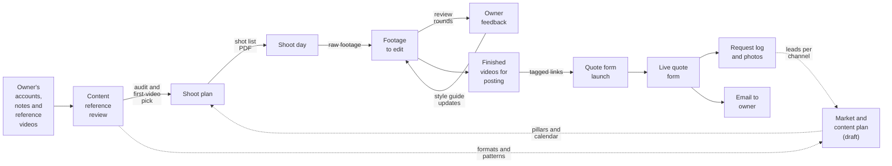

# Claude Code Skills for Small Service Businesses

**Context:** content and lead-capture support for a local window and gutter
cleaning company
**Period:** 2026
**Status:** versioned library; four skills used on one client engagement;
one draft

Five reusable Claude Code skills that take a small service business from
"here is my account and some videos I like" to finished short videos and a
live online quote form. Each skill is a written workflow with rules and, where
needed, bundled scripts or templates, so an AI agent can repeat the work for
the next client.

## 1. Problem

A small service business usually has no marketing team. The owner is busy
doing the work, posts to social media when there is time, and takes quote
requests by phone or through a weak web form.

I wanted the same work done consistently and cheaply: audit the accounts, plan
a shoot the owner can actually film, edit the footage into short vertical
videos, and capture quote requests online. And I wanted each step written down
as a skill an AI agent can follow again, so it doesn't have to be reinvented
for every client.

## 2. My role

- **What I did:** I designed the workflows and the rules for each skill:
  what goes in, the steps, what comes out, and what must never happen (for
  example, never repost another business's video, never commit client
  footage, never send a fake lead). I reviewed every output before it
  reached the client.
- **What an AI coding agent built under my direction:** Claude Code wrote
  the skills, the editing scripts and the quote form templates from my
  designs, and generalized them from the client's tools into versions that
  hold no client details.

## 3. System architecture

All client-specific settings (brand colours, fonts, logos, services, contact
details) live in the client's own folder. The skills read them at run time
and hold none of them.

## 4. Tech stack

- **Agent platform:** Claude Code skills (written workflows with rules,
  inputs and outputs)
- **Video and audio:** Python, ffmpeg, numpy, faster-whisper (speech to
  text), Silero VAD (speech detection), Demucs (separating voices from
  background sound)
- **Documents:** printable shot-list PDFs from Markdown
- **Lead capture:** HTML, CSS and JavaScript form; Google Apps Script;
  Google Sheets and Google Drive; GitHub Pages hosting with optional custom
  domain
- **Research:** headless browser for studying reference forms

## 5. Key features

### Content reference review

A repeatable way to start a content engagement. It audits a small business's
social accounts (what exists, what works, what's missing), then breaks a set
of reference videos into hooks, lengths, sound and caption choices, and groups
them into formats the business can realistically film. The result is a short
audit and a clear recommendation for the first video, grounded in evidence
rather than guesswork.

### Shoot plan

Turns a single video idea into a shot list a first-time camera operator can
follow on a phone. It covers must-get shots in shooting order, b-roll by
location, phone and audio settings with plain reasons, a privacy checklist,
and optional talking points for an owner who's new to the camera, exported as
a printable PDF. Shoot days stay short and the edit gets every shot it needs.

### Footage to edit

A complete short-video workflow built on ffmpeg and open-source audio tools.
It catalogues every clip with tags and clean-audio stretches, cuts vertical
videos from cut lists, removes filler words and off-camera voices, adds
captions checked by hand, and packages finished videos with covers and posting
notes. Each round of feedback feeds a per-client style guide, so later edits
follow what the client has already asked for.

### Quote form launch

Takes a service business from no online lead capture to a live, branded quote
form. It designs a mobile-first multi-step form, previews it for approval,
hosts it on GitHub Pages, and connects it to a Google Sheet that stores every
request, saves customer photos and emails the owner, with per-channel tracking
and setup for a custom domain. It costs little to run and the owner keeps the
data.

### Market and content plan (draft)

Researches a local service market (industry trends, seasonal demand,
competitors and buyers) and turns it into content pillars, a monthly calendar
tied to the seasons, a coaching guide for owners new to the camera, and a
simple way to measure leads per channel. It is designed to make content
planning repeatable across clients. It has not yet been used on a client.

## 6. Privacy and data protection

- **No client data in any skill:** the skills, scripts and templates hold
  no client names, places, prices, colours, logos or contact details.
- **Client settings stay with the client:** brand settings, footage, notes
  and plans live in the client's own folder. Footage is never committed to
  version control.
- **Quote form privacy notice and consent:** the form shows a short privacy
  notice and asks the customer to tick a consent box before a request can
  be sent.
- **Privacy checks in every shoot:** the shot list includes a privacy
  checklist (ask permission to film; keep house numbers, bystanders' faces,
  license plates and home interiors out of frame), and the edit flags any
  privacy issue in the footage.
- **Real addresses kept out of code:** the email recipients for quote
  requests are filled in only in a private copy given to the owner, never in
  the published form.
- **Respect for other businesses:** reference videos are studied, never
  reposted, copied or named in the client's content.
- **Music rights:** the edit prefers licensed or royalty-free music and
  flags songs that may not be cleared for business accounts.

## 7. Testing and validation

- **Human review of every output:** I reviewed each audit, shot list, edit
  and form before it reached the client.
- **Captions checked by hand:** every caption is checked against the audio,
  because speech-to-text often mishears brand names and numbers.
- **Versioned edit rounds:** every change produces a review copy, keeps the
  previous version, and logs what changed and why.
- **Quote form tested end to end:** the full flow is tested against a
  stand-in endpoint first, then the owner sends one live test from a phone.
  When studying another business's form, the agent stops before submitting,
  so no fake lead is ever sent.
- **Versioned library:** each skill follows semantic versioning, with a
  changelog and a documented change process. Automated validation checks
  and tests run on every pull request to the library. I am currently its
  only reviewer.

## 8. Results

- Four skills (content reference review, shoot plan, footage to edit and
  quote form launch) were used on one client engagement with a local window and
  gutter cleaning company.
- The quote form was taken live for the client.
- The work was generalized into five reusable skills, with the client's
  details removed, so it can be repeated for the next small business.
- The market and content plan skill is a draft and has not yet been
  used on a client.

## 9. What I would build next

- Complete the market and content plan skill on its first client and revise
  it from what that engagement teaches.
- A referral-partner skill that lists the partner types for an industry and
  supports outreach.
- A monthly lead report that combines the form's per-channel tracking with
  each video's posting date.

---

Descriptions only. Source code is private. All rights reserved.
